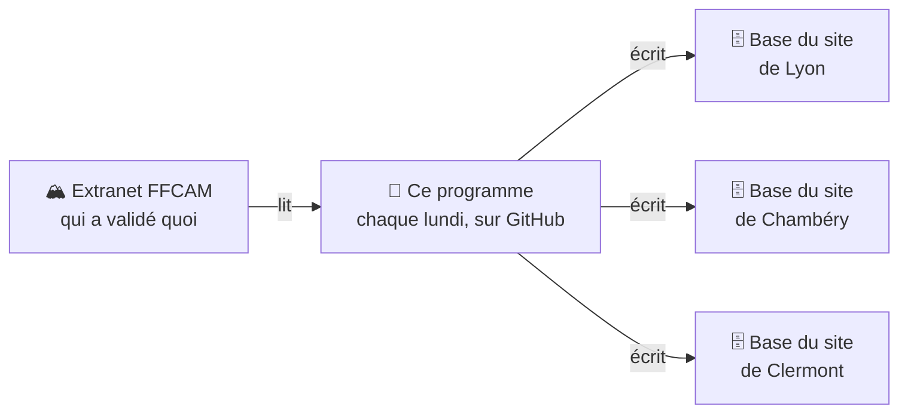

# Import FFCAM des formations et brevets

Chaque lundi matin, ce programme recopie depuis l'extranet de la FFCAM les **formations**, **brevets**, **niveaux de pratique** et **groupes de compétences** des adhérents d'un club dans la base de données du site du club. Il range chaque élément dans la bonne **commission** : escalade, alpinisme, ski de randonnée…

Le site du club sait ainsi qui a suivi quel stage, qui est initiateur et dans quelle activité, sans saisie à la main.

Trois clubs l'utilisent aujourd'hui : Lyon-Villeurbanne, Chambéry et Clermont-Ferrand. Chacun garde sa propre base et ses propres commissions.

## Par où commencer ?

| Vous êtes… | Lisez d'abord |
|---|---|
| Nouveau, vous voulez comprendre | [Comment ça marche](docs/comment-ca-marche.md), avec le [glossaire](docs/glossaire.md) sous la main |
| Responsable d'un club qui veut l'utiliser | [Ajouter un club](docs/ajouter-un-club.md) |
| Chargé de surveiller l'import | [Suivre et dépanner l'import](docs/suivre-et-depanner.md) |
| Développeur | [Développer](docs/developper.md) |

## L'essentiel en 5 questions

**D'où viennent les données ?** De l'extranet FFCAM, le site réservé aux clubs. Le programme s'y connecte avec le compte d'un membre du club, comme le ferait une personne, et le lit page par page. Il n'y écrit jamais.

**Quand tourne-t-il ?** Tous les lundis à 03:17 UTC (5 h 17 à Paris en été, 4 h 17 en hiver), sur GitHub Actions. On peut aussi le lancer à la main.

**Que faut-il à un club ?** Un compte FFCAM avec un profil extranet du club, l'accès à la base de son site, et un petit fichier qui traduit les codes de commission. Aucune ligne de code.

**Peut-il abîmer les données ?** Il vérifie la configuration avant d'écrire, ajoute et met à jour, mais n'efface jamais rien. Une panne de la FFCAM ne peut donc pas faire disparaître de validations.

**Les données personnelles sont-elles protégées ?** Le dépôt et ses logs sont publics : aucun nom ni numéro d'adhérent n'y apparaît. Les mots de passe sont rangés dans les secrets GitHub, jamais dans le code.

## Toute la documentation

- [Comment ça marche](docs/comment-ca-marche.md) : le déroulé d'un import, les données écrites, le rangement par commission.
- [Glossaire](docs/glossaire.md) : cafnum, brevet, référentiel, correspondance, environment…
- [Ajouter un club](docs/ajouter-un-club.md) : le guide pas à pas.
- [Suivre et dépanner l'import](docs/suivre-et-depanner.md) : lancer, lire le rapport, réagir à une alerte, corriger des données.
- [Développer](docs/developper.md) : installer, tester, ajouter une règle de rangement.
- [Les fichiers de configuration](config/README.md) : rangement des groupes de compétences et correspondances des clubs.
- [API de l'extranet FFCAM](docs/FFCAM-API.md) : ce qu'on sait de l'API non officielle que le programme interroge.
- [Décisions](docs/adr/) : pourquoi le projet est construit ainsi (ADR, *Architecture Decision Records*).

## Licence

MIT, voir [LICENSE](LICENSE).
