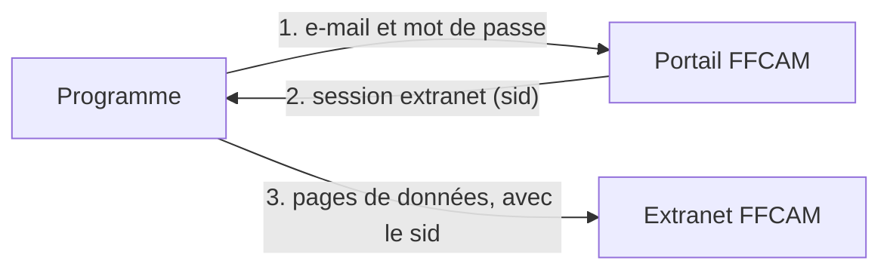
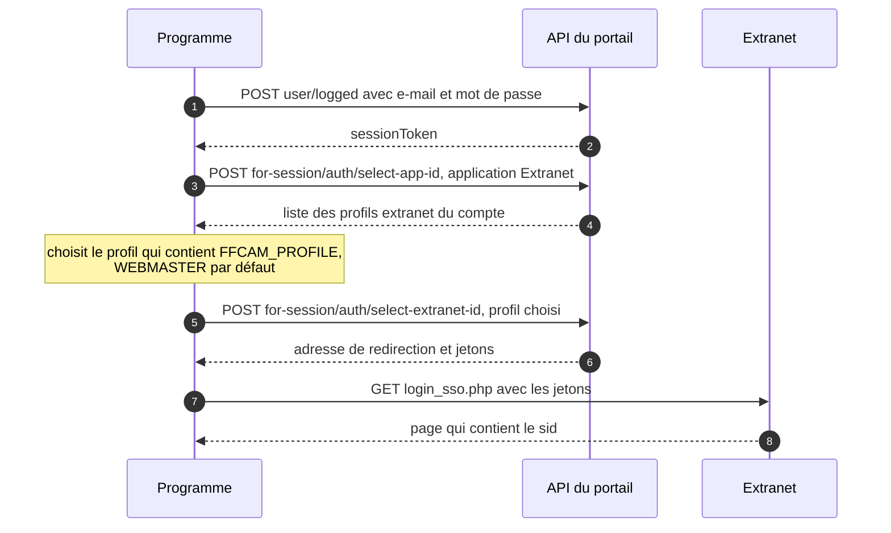

# L'API de l'extranet FFCAM

> ⚠️ Cette API n'est **pas officielle**. Tout ce qui suit a été découvert en observant le portail et l'extranet depuis un navigateur. La FFCAM peut la modifier sans prévenir : l'import échouerait alors au run suivant, en nommant l'étape en cause.

Cette page sert à comprendre ou réparer la partie du programme qui parle à la FFCAM (`src/auth/` et `src/scrapers/`). Les noms et numéros d'adhérent des exemples sont fictifs.

## Vue d'ensemble

Deux sites interviennent :

- **le portail** (`portail.ffcam.fr`, API sur `api.portail.ffcam.fr`), où l'on se connecte ;
- **l'extranet** (`extranet-clubalpin.com`), qui fournit les données sous forme de tableaux paginés.



## Se connecter : obtenir un `sid`

Le programme se connecte comme le ferait une personne, en 4 requêtes. Il n'y a ni captcha, ni double authentification.



Le détail des échanges :

```text
POST https://api.portail.ffcam.fr/user/logged                         {email, password}
  → {success: true, sessionToken: "JWT …"}
POST https://api.portail.ffcam.fr/for-session/auth/select-app-id      {appId: "extranet.xyntxutqx1"}   Authorization: JWT …
  → {action: "selectExtranet", extranetIds: [{extranetId: "15230", profile: "CLUB - WEBMASTER"}, …]}
     (ou directement {action: "redirect", …} si le compte n'a qu'un profil)
POST https://api.portail.ffcam.fr/for-session/auth/select-extranet-id {appId, extranetId}
  → {action: "redirect", redirectUri: "https://extranet-clubalpin.com/app/login_sso.php", accessToken, refreshToken}
GET  {redirectUri}?refreshToken=…&accessToken=…
  → HTML contenant : window.location.href = 'Effectifs/accueil.php?sid=XXXX&ish=…'
```

`appId` identifie l'application Extranet côté FFCAM ; il est le même pour tous les clubs.

Durées de vie observées : 100 jours pour le `sessionToken`, 30 jours pour le `refreshToken`, 5 minutes pour l'`accessToken`. Le `sid` expire après quelques heures d'inactivité, et quand le même compte se connecte ailleurs. Le programme se reconnecte alors tout seul.

## Lire les données

Toutes les données passent par une même adresse, qui renvoie un tableau découpé en pages :

```text
https://extranet-clubalpin.com/app/ActivitesFormations/jx_jqGrid.php
```

| Paramètre | Valeur |
|---|---|
| `sid` | La session obtenue ci-dessus (obligatoire) |
| `def` | Le tableau voulu : voir ci-dessous |
| `mode` | Toujours `liste` |
| `page` | Numéro de page, à partir de 1 |
| `rows` | Lignes par page, 150 au plus |
| `sidx`, `sord` | Colonne et sens du tri (`asc` ou `desc`) |
| `_search` | `false` |

Exemple :

```bash
curl "https://extranet-clubalpin.com/app/ActivitesFormations/jx_jqGrid.php?sid=ABC123XYZ&def=adh_formations&mode=liste&page=1&rows=150&sidx=jqGrid_adh_formations_NOMCOMPLET&sord=asc&_search=false"
```

Chaque réponse donne le nombre total de pages (`total`) et de lignes (`records`). Le programme lit les pages une à une, avec 300 ms de pause entre deux pages.

```json
{
  "page": 1,
  "total": 12,
  "records": 1792,
  "rows": [
    { "id": "12345", "cell": { "col_0": "690020240123", "col_1": "DUPONT Jean", "col_2": "…" } }
  ]
}
```

Chaque ligne est un objet `cell` aux colonnes numérotées (`col_0`, `col_1`…). `col_0` est toujours le cafnum, `col_1` le nom de l'adhérent. Le programme ne garde que les lignes dont le cafnum commence par le code du club, et ne recopie jamais le nom en base ni dans les logs.

### Les quatre tableaux

| Donnée | `def` | Taille observée |
|---|---|---|
| Formations | `adh_formations` | Les adhérents du club |
| Brevets | `adh_brevets` | **Nationale** : plus de 50 000 lignes, tous clubs confondus |
| Niveaux de pratique | `adh_niveaux_pratique` | Les adhérents du club |
| Groupes de compétences | `adh_groupe_competence` | Les adhérents du club |

### Formations (`adh_formations`)

| Colonne | Contenu |
|---|---|
| `col_0` | Cafnum |
| `col_1` | Nom de l'adhérent (non conservé) |
| `col_2` | Code de la formation, par exemple `STG-FES10` |
| `col_3` | Intitulé de la formation |
| `col_4` | Date de validation |
| `col_5` | Numéro de la session de formation |
| `col_6` | Formateur |
| `col_7` | Lieu |
| `col_8` | Identifiant interne FFCAM |
| `col_9` | Date de début |
| `col_10` | Date de fin |

### Brevets (`adh_brevets`)

| Colonne | Contenu |
|---|---|
| `col_0` | Cafnum |
| `col_1` | Nom de l'adhérent (non conservé) |
| `col_2` | Code du brevet, par exemple `BF1-ES-SAE` |
| `col_3` | Intitulé du brevet |
| `col_4` | Date d'obtention |
| `col_5` | Date de recyclage |
| `col_6` | Date d'édition du diplôme |
| `col_7` | Identifiant interne FFCAM (non conservé) |
| `col_8` | Commentaire (non conservé) |
| `col_9` | Date de formation continue |
| `col_10` | Date de migration |

### Niveaux de pratique (`adh_niveaux_pratique`)

| Colonne | Contenu |
|---|---|
| `col_0` | Cafnum |
| `col_1` | Nom de l'adhérent (non conservé) |
| `col_2` | Code du club, par exemple `6900` : le `check` s'en sert pour vérifier que le profil est celui du bon club |
| `col_4` | Code de l'activité : `ES`, `AL`, `SN`… |
| `col_5` | Activité : `ESCALADE`… |
| `col_6` | Niveau, par exemple `INITIE en escalade sur SAE` |
| `col_7` | Date de validation |

Cette réponse a aussi un champ `userData.caliData`, indexé par l'`id` de chaque ligne. Il donne notamment `_BASE_cursus_niveau_pratique_id`, l'identifiant du niveau dans le référentiel FFCAM, et `_BASE_validation_qui`, la personne qui a validé.

### Groupes de compétences (`adh_groupe_competence`)

| Colonne | Contenu |
|---|---|
| `col_0` | Cafnum |
| `col_1` | Nom de l'adhérent (non conservé) |
| `col_2` | Code du club |
| `col_4` | Code de l'activité |
| `col_5` | Activité |
| `col_6` | Intitulé du groupe, par exemple `2.2 Progression sur glacier 1` |
| `col_7` | Niveau associé, par exemple `INITIE en escalade sur SAE` |
| `col_8` | Date de validation |
| `col_9` | Statut, en HTML : validé si la cellule contient `text-vert` et `fa-circle` |
| `col_10` | Validé par |
| `col_11` | Commentaire |

Les dates arrivent au format `AAAA-MM-JJ` ou `JJ/MM/AAAA`. `0000-00-00` veut dire « pas de date ».

## Codes d'activité

| Code | Activité |
|---|---|
| `AL` | ALPINISME |
| `CA` | DESCENTE DE CANYON |
| `ES` | ESCALADE |
| `RA` | RANDONNEE |
| `SN` | SPORTS DE NEIGE |
| `VM` | VELO DE MONTAGNE |

Pour les sports de neige, la discipline précise l'activité : `Randonnée` (ski de randonnée), `Piste` (ski alpin), `Fond`, `Raquettes`, `Snowboard`, `Nordique` (ski de randonnée nordique).

## Quand ça se passe mal

| Ce qu'on reçoit | Ce que ça veut dire | Ce que fait le programme |
|---|---|---|
| Une page HTML au lieu de JSON | Session refusée : `sid` expiré, ou profil changé | Se reconnecte et rejoue la page, 2 fois au plus par tableau |
| Un JSON illisible | Erreur côté FFCAM, souvent passagère (panne du 29/09/2026) | Se reconnecte, réessaie, puis décrit l'erreur sans en citer le contenu |
| Une erreur réseau, un délai dépassé (60 s), une erreur HTTP 5xx, 408 ou 429 | Problème passager | Réessaie après 1, 2 puis 4 secondes : 4 essais en tout |
| Une autre erreur HTTP 4xx | Requête refusée | Abandonne la page sans réessayer |

Une page toujours illisible après ses essais est notée « page manquante » : l'import continue avec les autres pages, puis se termine en échec pour qu'on le relance. Seule exception, la page 1 : sans elle, on ne connaît pas le nombre de pages, et le tableau entier est perdu.

## Historique

| Date | Observation |
|---|---|
| 2025-10 | Première documentation de l'API |
| 2026-09 | Connexion par le portail (SSO) au lieu d'un `sid` copié à la main |
| 2026-09-29 | Panne passagère : réponses JSON illisibles sur une partie des pages |
| 2026-10-18 | Colonnes des quatre tableaux revérifiées d'après le code |
