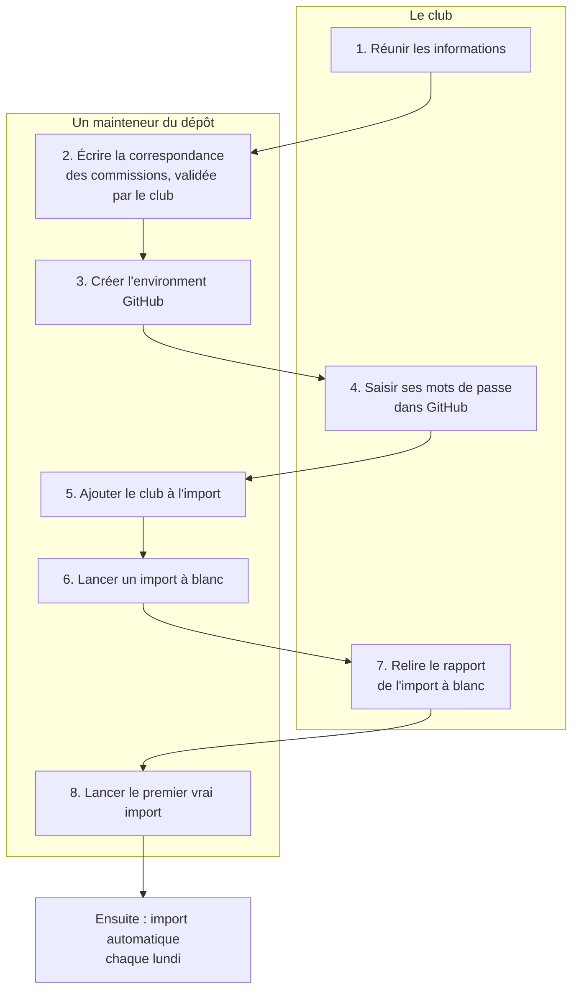

# Ajouter un club

Ce guide accompagne un nouveau club, du premier contact jusqu'à l'import automatique du lundi. Il n'y a aucune ligne de code à écrire : tout tient en quelques réglages et un petit fichier.

Si vous découvrez le projet, lisez d'abord [Comment ça marche](comment-ca-marche.md). Les mots techniques sont expliqués dans le [glossaire](glossaire.md).

## Qui fait quoi ?

Deux personnes interviennent :

- **Le club** : un membre qui a un **profil extranet du club** à la FFCAM (par exemple « CLUB - WEBMASTER ») et qui connaît les commissions du site.
- **Un mainteneur du dépôt** : une personne qui administre le dépôt GitHub, aujourd'hui à Lyon.



## 1. Réunir les informations

| Information | Exemple | Où la trouver |
|---|---|---|
| Code du club | `6300` | Les 4 premiers chiffres d'un numéro d'adhérent du club |
| Nom court du club | `clermont` | À choisir : minuscules, sans accent ni espace. Il nomme le dossier `config/clubs/clermont/` |
| Compte FFCAM | e-mail et mot de passe du portail | Un membre qui a un profil extranet du club |
| Accès à la base du site | hôte, port, utilisateur, mot de passe, nom de la base | Chez l'hébergeur du site (sur Clever Cloud : les variables `MYSQL_ADDON_*`) |
| Liste des commissions du site | code et titre de chaque commission | La table `caf_commission` de la base du site |

Quelques précautions :

- **Le compte FFCAM** sert chaque lundi. Si son mot de passe change, l'import échoue jusqu'à ce que le nouveau soit saisi dans GitHub. Si le compte a plusieurs profils extranet, le programme prend celui qui contient « WEBMASTER » ; pour un autre, on le précise dans la variable `FFCAM_PROFILE`.
- **La base du site** doit déjà contenir les tables `formation_*`. C'est la plateforme du site qui les crée, pas ce programme. Le programme lit `caf_user` et `caf_commission`, et écrit dans les tables `formation_*`.

## 2. Écrire la correspondance des commissions

C'est l'étape qui demande le plus de réflexion. Le mapping range chaque code FFCAM dans une des 19 commissions de Lyon, avec les codes de Lyon. La correspondance dit, pour chacun de ces 19 codes, où il va dans **votre** club.

### Les 19 codes à placer

| Code de Lyon | Ce qu'il reçoit |
|---|---|
| `alpinisme` | Alpinisme, cascade de glace, terrain d'aventure, guide de haute montagne |
| `canyon` | Canyon, unités eau vive |
| `environnement` | Formations à l'écologie et à la protection de la montagne, Brevet Avenir Montagne |
| `escalade` | Escalade sur mur (SAE) et en falaise (SNE), grandes voies, escalade sur glace |
| `formation` | Secourisme (PSC1), formations communes à toutes les activités, gestion des équipements (EPI) |
| `marche-nordique` | Marche nordique |
| `randonnee` | Randonnée montagne et randonnée alpine, cartographie et orientation |
| `raquette` | Raquette à neige |
| `ski-de-fond` | Ski de fond |
| `ski-de-piste` | Ski alpin, hors-piste, télémark |
| `ski-de-randonnee` | Ski de randonnée et ski alpinisme, neige et avalanches |
| `ski-randonnee-nordique` | Ski de randonnée nordique |
| `slackline` | Slackline |
| `snowboard-rando` | Snowboard de randonnée et snowboard alpinisme |
| `speleologie` | Spéléologie |
| `trail` | Trail |
| `via-ferrata` | Via ferrata |
| `vie-du-club` | Formation des dirigeants : trésorerie, communication, extranet |
| `vtt` | Vélo de montagne |

Certains éléments vont dans deux commissions : un brevet de trail alimente `randonnee` et `trail`, un brevet de via ferrata alimente `escalade` et `via-ferrata`.

### Les quatre réponses possibles

Pour chaque code, mettez la liste ci-dessus à côté de votre table `caf_commission`, et choisissez :

| Situation dans votre club | Ce qu'on écrit | Exemple |
|---|---|---|
| Vous avez une commission avec **exactement** ce code | Rien | Clermont a `escalade` : pas de ligne |
| Votre commission porte un autre code | Une ligne `code,votre_code` | `canyon,canyoning` |
| Le code concerne plusieurs de vos commissions | Une ligne par commission | `randonnee,randonnee-montagne` puis `randonnee,randonnee-alpine` |
| Vous n'avez pas de commission pour cette activité | Une ligne avec une cible vide | `speleologie,` |

> ⚠️ **Vérifiez aussi les codes identiques.** Chez Clermont, `ski-de-randonnee` désigne le ski de randonnée **nordique**. Sans ligne, le ski de randonnée de Lyon y aurait été rangé par erreur. Clermont a donc deux lignes : `ski-de-randonnee,ski-de-rando-alpine` et `ski-randonnee-nordique,ski-de-randonnee`.

### Le fichier

Il s'appelle `config/clubs/<club>/correspondance-commissions.csv`. Il commence toujours par la ligne `code,code_club`, puis une ligne par traduction. Celui de Chambéry, par exemple :

```csv
code,code_club
escalade,escalade-adulte
randonnee,randonnee-pedestre
ski-de-randonnee,ski-alpinisme
ski-de-randonnee,ski-alpinisme-competition
via-ferrata,
```

Le fichier est obligatoire, même vide (la ligne `code,code_club` seule) : il empêche de charger par erreur la configuration d'un autre club. Il s'ajoute au dépôt par une PR. Faites relire et valider les choix par le club, puis notez-les dans l'[ADR 0002](adr/0002-rattachement-aux-commissions-et-exploitation.md) : on saura plus tard pourquoi tel code va dans telle commission.

Les groupes de compétences, eux, sont rangés par un tableau commun à tous les clubs (voir [config/README.md](../config/README.md)). Si votre club veut les répartir autrement, signalez-le : ce n'est pas encore prévu.

## 3. Créer l'environment GitHub (mainteneur)

Un environment est le coffre des réglages d'une base. Dans le dépôt : **Settings → Environments → New environment**.

1. Nommez-le `<club>-prod`, par exemple `clermont-prod`.
2. Dans **Deployment branches**, choisissez **Protected branches only**. Seul le code relu et mergé dans `main` pourra alors lire les mots de passe du club.
3. Ajoutez les **variables** :

| Variable | Exemple | Rôle |
|---|---|---|
| `CLUB` | `clermont` | Le nom du dossier `config/clubs/` |
| `CLUB_CODE` | `6300` | Le code du club |
| `FFCAM_PROFILE` | `WEBMASTER` | Facultatif : le profil extranet à utiliser, si le compte en a plusieurs |

## 4. Saisir les mots de passe (club)

Dans le même environment, sous **Environment secrets**, le club saisit ses **secrets**. Une fois enregistré, un secret n'est plus lisible par personne, administrateurs compris. Pour cela, un mainteneur donne au membre du club un accès administrateur au dépôt.

| Secret | Contenu | Qui le saisit |
|---|---|---|
| `FFCAM_EMAIL` | E-mail du compte FFCAM | Le membre du club qui possède le compte |
| `FFCAM_PASSWORD` | Mot de passe du compte FFCAM | Le membre du club qui possède le compte |
| `MYSQL_ADDON_HOST` | Adresse du serveur de la base | Le club, ou un mainteneur qui y a accès |
| `MYSQL_ADDON_PORT` | Port, souvent `3306` | idem |
| `MYSQL_ADDON_USER` | Utilisateur de la base | idem |
| `MYSQL_ADDON_PASSWORD` | Mot de passe de la base | idem |
| `MYSQL_ADDON_DB` | Nom de la base | idem |

Le mot de passe FFCAM ne passe ainsi par personne d'autre que son propriétaire.

## 5. Ajouter le club à l'import (mainteneur)

Dans une PR, ajoutez le nom de l'environment à deux endroits de [`.github/workflows/import.yml`](../.github/workflows/import.yml) : la liste `options` du lancement manuel et la liste `matrix.environment` du run du lundi. Mettez aussi à jour la liste des clubs dans la documentation (README, glossaire, [Comment ça marche](comment-ca-marche.md)).

Mergez la PR quand les secrets sont saisis. À partir de là, le club fait partie de l'import du lundi : faites l'import à blanc avant.

## 6. Lancer un import à blanc (mainteneur)

Un import à blanc fait tout, sauf écrire. Dans le dépôt : **Actions → Import FFCAM → Run workflow**.

- Branche : `main`. L'environment n'accepte que les branches protégées : c'est pour cela qu'on teste après le merge.
- Environment à synchroniser : `<club>-prod`. Ne laissez surtout pas « tous », qui lancerait aussi les imports des autres clubs.
- Cochez **Import à blanc**.

## 7. Relire le rapport (club et mainteneur)

Ouvrez le run, puis le job, puis l'étape « Vérification de la configuration puis import ». On vérifie :

- que toutes les lignes du `check` sont en ✅, en particulier « Le profil extranet est bien celui du club » et « Toutes les commissions attendues par le mapping existent » ;
- les nombres de lignes importées et ignorées : quelques pour cent d'ignorées, c'est normal ;
- les alertes en fin de rapport, expliquées dans [Suivre et dépanner l'import](suivre-et-depanner.md#les-alertes-du-rapport).

## 8. Lancer le premier vrai import (mainteneur)

Même chose qu'à l'étape 6, sans cocher « Import à blanc ». Comptez 20 minutes à 1 h 20. Ensuite, vérifiez sur le site que les formations apparaissent dans les bonnes commissions.

C'est fini : le club est importé automatiquement chaque lundi.

## Pour les plus techniques : tester depuis son ordinateur

On peut faire les étapes 6 et 7 en local, avant même de créer l'environment. Installez le projet (voir [Développer](developper.md)), puis :

```bash
cp .env.example .env       # remplir avec les informations de l'étape 1
npm run check              # chaque ❌ dit quoi corriger
npm run import:dry         # import à blanc
```

N'utilisez jamais le compte FFCAM en local pendant qu'un import tourne sur GitHub : les deux connexions se voleraient la session.

## Récapitulatif

- [ ] Code du club, nom court, compte FFCAM, accès à la base, liste des commissions
- [ ] `config/clubs/<club>/correspondance-commissions.csv`, validé par le club, choix notés dans l'ADR 0002
- [ ] Environment `<club>-prod` limité aux branches protégées, variables `CLUB` et `CLUB_CODE`
- [ ] Les 7 secrets saisis
- [ ] Environment ajouté dans `import.yml` (deux endroits) et dans la documentation
- [ ] PR mergée
- [ ] Import à blanc relu
- [ ] Premier vrai import fait et vérifié sur le site
