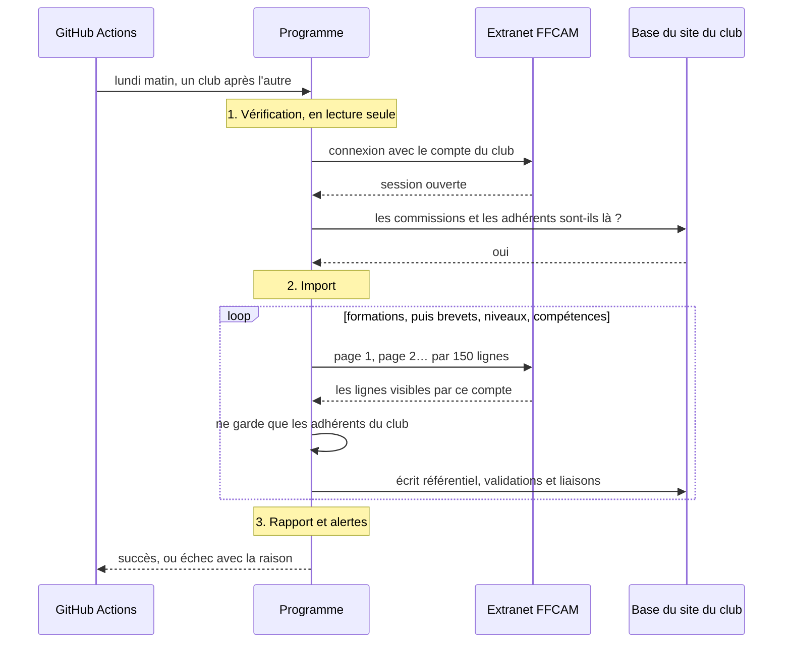
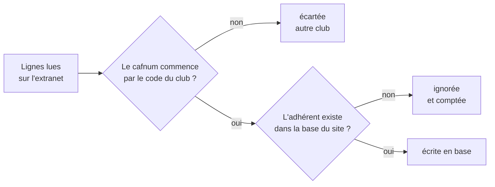
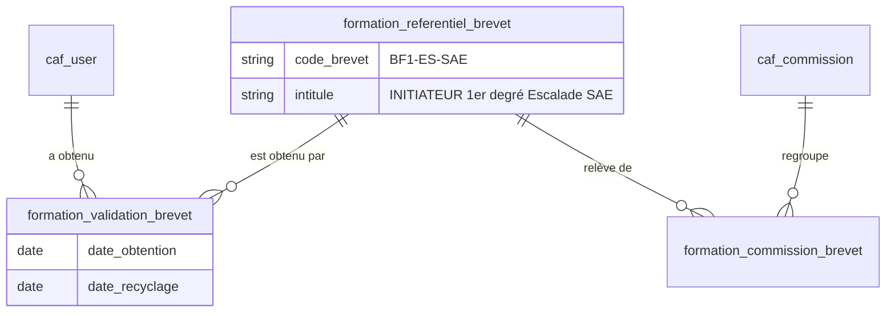
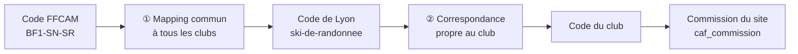
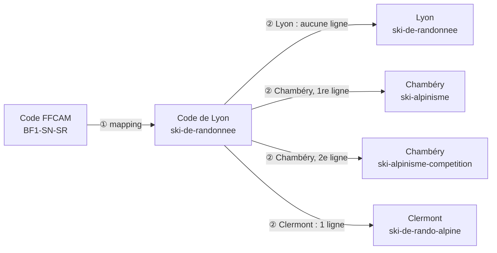

# Comment ça marche

Cette page explique, sans entrer dans le code, ce que fait le programme, ce qu'il écrit dans la base du site et comment il range chaque élément dans une commission. Un mot vous échappe ? Il est sans doute dans le [glossaire](glossaire.md).

## En une phrase

Le programme se connecte à l'extranet FFCAM avec le compte d'un membre du club, lit les formations, brevets, niveaux et compétences des adhérents, ne garde que ceux du club, puis les écrit dans la base du site en indiquant à quelle commission chacun appartient.

## Le déroulé d'un import

Chaque lundi, GitHub Actions lance le programme une fois par base : `lyon-staging`, `lyon-prod`, `chambery-prod` et `clermont-prod`. Les bases passent l'une après l'autre, dans un ordre qui peut varier. Un import dure de 20 minutes à 1 h 20 selon le club.

1. **La vérification** (`check`) contrôle tout ce qui peut être contrôlé sans rien écrire : les réglages du club, la connexion à la FFCAM, le fait que le compte voit bien le bon club, la connexion à la base et la présence des commissions attendues. Au moindre problème, l'import ne démarre pas.
2. **L'import** lit l'extranet page par page, avec une courte pause entre deux pages pour ne pas surcharger la FFCAM. Une page en erreur est essayée jusqu'à 4 fois. Si la session expire en route, le programme se reconnecte tout seul.
3. **Le rapport**, en fin d'import, donne pour chaque type le nombre de lignes importées et ignorées, puis les alertes : une commission absente, un code que le mapping ne reconnaît pas… Un import incomplet se termine en échec, et GitHub envoie un e-mail.

## Quelles données sont gardées ?

L'extranet montre souvent plus que les adhérents du club : la grille des brevets, par exemple, est nationale (plus de 50 000 lignes). Le programme fait donc deux tris :

Une ligne « ignorée » concerne en général un ancien adhérent, ou une adhésion pas encore reportée dans le site. Le rapport les compte : quelques pour cent, c'est normal. Une proportion anormale signale un mauvais `CLUB_CODE`.

## Ce qui est écrit dans la base

Pour chacun des quatre types, le programme remplit trois tables. Prenons un brevet :

- **Le référentiel** (`formation_referentiel_brevet`) : le catalogue, une ligne par code. `BF1-ES-SAE` n'y figure qu'une fois, même si 40 adhérents l'ont.
- **Les validations** (`formation_validation_brevet`) : qui a quoi, avec les dates. Une ligne par adhérent et par brevet.
- **Les liaisons** (`formation_commission_brevet`) : à quelle commission appartient chaque code. `BF1-ES-SAE` relève de l'escalade.

`caf_user` (les adhérents) et `caf_commission` (les commissions) appartiennent au site : le programme les lit, il ne les modifie jamais.

| Type | Référentiel | Validations | Liaisons aux commissions |
|---|---|---|---|
| Formations | `formation_referentiel_formation` | `formation_validation_formation` | `formation_commission_formation` |
| Brevets | `formation_referentiel_brevet` | `formation_validation_brevet` | `formation_commission_brevet` |
| Niveaux de pratique | `formation_referentiel_niveau_pratique` | `formation_validation_niveau_pratique` | `formation_commission_niveau_pratique` |
| Groupes de compétences | `formation_referentiel_groupe_competence` | `formation_validation_groupe_competence` | `formation_commission_groupe_competence` |

La table `formation_last_sync` garde la date du dernier import réussi de chaque type. Elle n'est mise à jour que si le type a été importé en entier, sans page manquante ni erreur d'écriture.

## Le rangement par commission

C'est la partie la plus délicate : la FFCAM ne dit pas à quelle commission d'un club appartient un brevet, et chaque club nomme ses commissions à sa façon. Le rangement se fait donc en deux étapes.

### ① Le mapping, commun à tous les clubs

Il dit, avec les codes de commission de Lyon, à quelle activité appartient chaque code FFCAM. La méthode dépend du type :

| Type | Méthode | Où c'est écrit |
|---|---|---|
| Brevets et formations | Des **patterns** reconnaissent les codes par leur début : un code de formation qui commence par `STG-FCA` va en `canyon` | [`src/utils/commission-mapping.ts`](../src/utils/commission-mapping.ts) |
| Groupes de compétences | Un **tableau** donne la ou les commissions de chaque intitulé | [`config/groupes-competences-commissions.csv`](../config/groupes-competences-commissions.csv) |
| Niveaux de pratique | L'**activité** et la discipline données par la FFCAM, sinon l'intitulé du niveau, avec un degré de certitude | [`src/utils/commission-mapping.ts`](../src/utils/commission-mapping.ts) |

Un même code peut aller dans plusieurs commissions : un brevet de trail alimente à la fois `randonnee` et `trail`.

Un code qu'aucune règle ne reconnaît est importé, mais rattaché à aucune commission. Le rapport d'import le signale chaque semaine, jusqu'à ce qu'on ajoute la règle qui manque (voir [Suivre et dépanner](suivre-et-depanner.md#les-alertes-du-rapport)).

### ② La correspondance, propre à chaque club

Chaque club a un fichier `config/clubs/<club>/correspondance-commissions.csv` qui traduit les codes de Lyon vers les siens. Quatre cas possibles :

| Dans le fichier du club | Effet | Exemple |
|---|---|---|
| Aucune ligne pour ce code | Le code est gardé tel quel | Lyon n'a presque rien à traduire |
| Une ligne | Le code est traduit | Chambéry : `escalade` → `escalade-adulte` |
| Plusieurs lignes | Le code alimente plusieurs commissions | Clermont : `randonnee` → `randonnee-montagne` **et** `randonnee-alpine` |
| Une ligne avec une cible vide | Le code est ignoré | Lyon : `speleologie`, faute de commission spéléo |

### Un exemple complet

Le brevet `BF1-SN-SR` « INITIATEUR 1er degré Ski de randonnée » :

Attention au piège : chez Clermont, le code `ski-de-randonnee` existe, mais il désigne le ski de randonnée **nordique**. Sans sa ligne de correspondance, le ski de randonnée de Lyon y serait rangé par erreur, puisqu'un code sans ligne est gardé tel quel. D'où l'importance de vérifier chaque code, même ceux qui semblent identiques.

## Les garde-fous

**Rien n'est écrit sans vérification.** Le `check` passe avant chaque import et l'arrête au moindre problème.

**L'import n'efface jamais rien.** Il ajoute et met à jour, c'est tout. Une panne de l'extranet ou un code renommé par la FFCAM ne peut donc pas faire disparaître de validations. La contrepartie : quand on corrige une règle de rangement, l'ancienne liaison reste en base et doit être retirée à la main (voir [Corriger des données à la main](suivre-et-depanner.md#corriger-des-données-à-la-main)).

**On peut le relancer sans risque.** Relancer un import donne le même résultat, sans doublon : chaque ligne déjà présente est mise à jour.

**Un import incomplet est un échec.** Une page illisible après 4 tentatives, ou une erreur d'écriture en base, fait terminer l'import en erreur. Il ne passe jamais pour un succès.

**Un seul import à la fois.** Les clubs passent l'un après l'autre : deux connexions simultanées du même compte FFCAM se voleraient la session.

**Aucune donnée personnelle dans les logs.** Le dépôt est public, ses logs aussi. Ils ne contiennent ni nom ni numéro d'adhérent, et la session FFCAM y est masquée.

## Pour aller plus loin

- [Ajouter un club](ajouter-un-club.md)
- [Suivre et dépanner l'import](suivre-et-depanner.md)
- [Développer](developper.md), pour l'organisation du code
- [Les décisions et leurs raisons](adr/)
