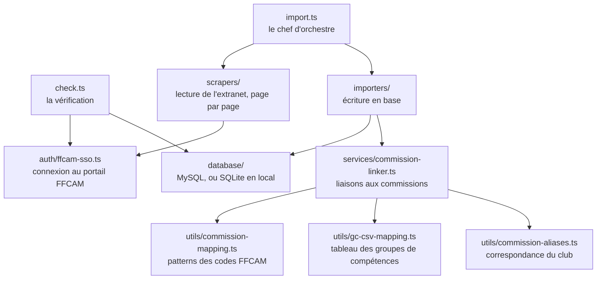

# Développer

Cette page sert à modifier le programme : l'installer, le lancer, comprendre l'organisation du code, et faire la modification la plus courante, ajouter une règle de rangement. Pour le fonctionnement général, lisez d'abord [Comment ça marche](comment-ca-marche.md).

## Installer

Il faut **Node.js 24** (la version est dans `.nvmrc`) et **pnpm 10**.

```bash
git clone https://github.com/Club-Alpin-Lyon-Villeurbanne/ffcam-formations-scraper.git
cd ffcam-formations-scraper
nvm use          # prend la version de .nvmrc
pnpm install
```

Le programme est écrit en TypeScript et lancé directement avec `tsx`, sans étape de compilation. Il n'utilise aucun framework : le `fetch` de Node pour l'extranet, `mysql2` pour la base, `vitest` pour les tests.

## Configurer

Copiez `.env.example` en `.env` et remplissez-le. Chaque variable y est expliquée.

```bash
cp .env.example .env
```

Le fichier lu dépend de `NODE_ENV` :

| `NODE_ENV` | Fichier lu |
|---|---|
| non défini | `.env` |
| `staging` | `.env.staging` |
| `production` | `.env.production` |

Ces fichiers contiennent des mots de passe : ils sont ignorés par git et ne doivent jamais être commités. Une variable déjà définie dans le terminal l'emporte sur le fichier.

Sans les variables `MYSQL_ADDON_*`, le programme écrit dans une base SQLite locale (`data/local.db`). Elle sert seulement à travailler sur la lecture de l'extranet : elle n'a ni adhérents ni commissions, et le `check` la refuse.

## Les commandes

| Commande | Ce qu'elle fait |
|---|---|
| `npm run check` | Vérifie la configuration, en lecture seule |
| `npm run import:dry` | Import à blanc : lit tout, n'écrit rien |
| `npm run import` | Vrai import des quatre types |
| `npm run import:formations` | Un seul type ; idem avec `:brevets`, `:niveaux`, `:competences` |
| `npm run diagnostic:brevets -- --mysql` | Liste les brevets de la base qui n'ont aucune commission |
| `npm run test` | Lance les tests (`test:watch` pour les relancer à chaque modification) |
| `npm run type-check` | Vérifie les types TypeScript |

Pour viser une autre base, préfixez la commande : `NODE_ENV=staging npm run import:dry`.

> ⚠️ Un import depuis votre ordinateur utilise le compte FFCAM du club. Ne le lancez jamais pendant un run GitHub : les deux connexions se voleraient la session.

## L'organisation du code



Un import suit ce chemin : `import.ts` demande à un **scraper** les lignes d'un type, puis les passe à l'**importer** du même type, qui les écrit en base et demande au **linker** de rattacher chaque code à ses commissions, une fois par code et par import. Il y a un scraper et un importer par type, qui partagent une classe de base (`base-scraper.ts`, `base-importer.ts`).

```text
src/
├── import.ts               le programme principal
├── check.ts                npm run check
├── diagnostic-brevets.ts   npm run diagnostic:brevets
├── config.ts               variables d'environnement, code du club
├── types.ts                types partagés
├── auth/                   connexion SSO au portail, obtention du sid
├── scrapers/               un fichier par type, plus la base commune
├── importers/              un fichier par type, plus la base commune
├── services/               commission-linker.ts
├── database/               connexion MySQL, base SQLite de développement
└── utils/                  mapping, tableau des GC, correspondance, logs
config/                     tableau des GC et correspondances des clubs (voir config/README.md)
docs/                       cette documentation
.github/workflows/          ci.yml (tests), import.yml (import du lundi)
```

Les tests sont à côté du code qu'ils testent : `commission-mapping.test.ts` à côté de `commission-mapping.ts`.

## Ajouter ou corriger une règle de rangement

C'est la modification la plus fréquente. Elle arrive quand le rapport d'import signale un `CODE(S) DE BREVET OU FORMATION SANS COMMISSION`, ou quand un code est rangé dans la mauvaise commission.

**1. Trouver l'intitulé du code.** Il est dans la table `formation_referentiel_brevet` ou `formation_referentiel_formation` de la base, ou sur l'extranet. On range d'après l'intitulé FFCAM, jamais d'après l'abréviation du code : `SN-SA` est le « Ski alpinisme », donc du ski de randonnée, pas du ski alpin.

**2. Choisir la commission.** Parmi les 19 codes de Lyon (voir [Ajouter un club](ajouter-un-club.md#les-19-codes-à-placer)). Un brevet va dans la même commission que la formation qui y mène. Si le code relève de deux activités, il reçoit deux règles.

**3. Écrire la règle** dans `src/utils/commission-mapping.ts`, liste `BREVET_PATTERNS` ou `FORMATION_PATTERNS`, dans le groupe de l'activité :

```ts
{ pattern: /^STG-UFEV/i, commission: 'canyon' },     // UF Eau vive
```

Le `^` impose que le code **commence** par `STG-UFEV`. Gardez la règle assez précise pour ne pas attraper d'autres codes par accident.

**4. Ajouter un test** dans `src/utils/commission-mapping.test.ts`, dans le groupe de l'activité, puis lancez `npm run test`.

**Cas particuliers :**

- Le code ne relève d'aucune commission (juge-arbitre, gratuité…) : ajoutez-le à la liste `SANS_COMMISSION` du même fichier, pour que le rapport cesse de le signaler.
- La règle utilise un **nouveau** code de commission, comme `slackline` : ajoutez une ligne pour ce code dans la correspondance de **chaque** club, pour le traduire ou l'ignorer. Sinon le `check` du club échoue sur une commission absente.

**5. Après le merge**, tout dépend du cas :

| Cas | Ce qu'il faut faire ensuite |
|---|---|
| Code jusque-là sans commission | Rien : l'import suivant crée les liaisons |
| Code rangé dans la mauvaise commission | L'ancienne liaison reste : nettoyage à la main dans chaque base (voir [Suivre et dépanner](suivre-et-depanner.md#cas-2--une-règle-de-rangement-corrigée)) |

Notez les choix qui ne vont pas de soi dans l'[ADR 0002](adr/0002-rattachement-aux-commissions-et-exploitation.md).

## Ajouter un groupe de compétences au tableau

Les groupes de compétences sont rangés par le tableau `config/groupes-competences-commissions.csv`, une ligne par groupe et par commission. Son format est décrit dans [config/README.md](../config/README.md). Quand la FFCAM renomme un groupe, on ajoute le nouvel intitulé avec les mêmes commissions que l'ancien (voir [Suivre et dépanner](suivre-et-depanner.md#cas-1--un-groupe-de-compétences-renommé-par-la-ffcam)).

## Tests et intégration continue

À chaque PR et à chaque push sur `main`, le workflow [`ci.yml`](../.github/workflows/ci.yml) vérifie les types, lance les tests avec la couverture, compile le projet et exécute `pnpm audit`, qui bloque sur une faille de sécurité haute ou critique. Ne mergez une PR que si tout est vert.

Les actions GitHub sont épinglées par leur empreinte (SHA) plutôt que par leur version : une action piratée ne peut pas s'introduire en douce. Dependabot propose leurs mises à jour chaque mois.

## Les règles du projet

- **Simple avant tout** : pas de framework, pas d'abstraction sans besoin prouvé. Des commentaires rares, qui disent pourquoi plutôt que quoi.
- **Aucune donnée d'adhérent dans les logs** : ni nom ni cafnum, la session masquée, les erreurs MySQL réduites à leur code (MySQL recopie parfois la valeur fautive dans son message). Le dépôt et ses logs sont publics.
- **L'import n'efface jamais rien** : il ajoute et met à jour. Les corrections se font à la main, après relecture.
- **Un import incomplet est un échec** : une page manquante ou une erreur d'écriture doit faire échouer le run, jamais passer inaperçue.
- **Les décisions importantes vont dans un ADR** ([docs/adr/](adr/)), avec leur raison.
