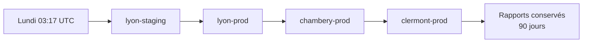
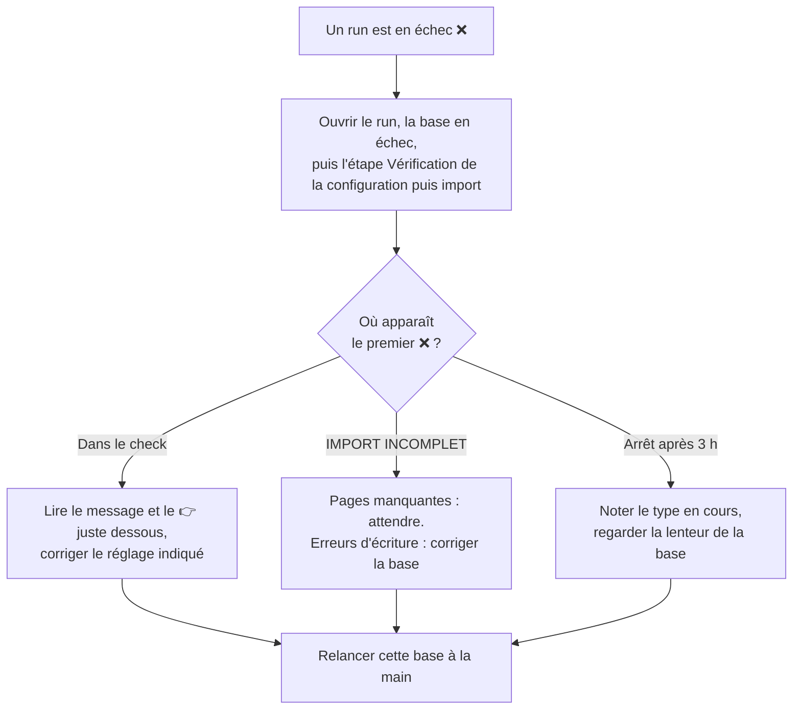
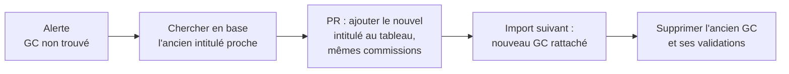
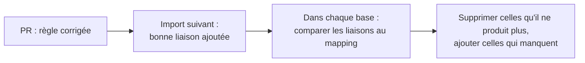

# Suivre et dépanner l'import

Cette page sert à celles et ceux qui veillent sur l'import : le lancer à la main, lire son rapport, réagir à une alerte ou à un échec, corriger des données. Pour le fonctionnement général, voir [Comment ça marche](comment-ca-marche.md) ; pour les mots techniques, le [glossaire](glossaire.md).

## Le run du lundi

Tous les lundis à 03:17 UTC (5 h 17 à Paris en été, 4 h 17 en hiver), GitHub Actions importe chaque base, l'une après l'autre. Pour chacune, il lance d'abord la vérification (`check`), puis l'import.



L'ordre des bases peut varier, et l'échec de l'une n'empêche pas les suivantes. Durées habituelles :

| Base | Durée habituelle |
|---|---|
| `lyon-staging`, `lyon-prod` | 50 minutes environ |
| `chambery-prod` | 50 à 80 minutes |
| `clermont-prod` | 20 minutes environ |

Au-delà de 3 heures, GitHub arrête l'import d'une base : c'est le signe d'un vrai blocage.

**En cas d'échec**, GitHub envoie un e-mail à la personne qui a modifié en dernier la ligne `cron` du workflow. On peut aussi consulter l'onglet **Actions** du dépôt : chaque run y est marqué ✅ ou ❌.

## Lancer un import à la main

Dans le dépôt : **Actions → Import FFCAM → Run workflow**.

| Option | Choix |
|---|---|
| Branche | `main` (les environments de production refusent les autres branches) |
| Environment à synchroniser | La base voulue. ⚠️ « tous », la valeur par défaut, lance **toutes** les bases, production comprise |
| Import à blanc | Cochée : tout est lu et vérifié, rien n'est écrit. Décochée : vrai import |

On lance un import à la main :

- **après un échec**, une fois la cause corrigée, pour ne pas attendre le lundi suivant ;
- **après un changement** (réglages d'un club, version de Node ou d'une action GitHub), en import à blanc, avant le lundi : le run du lundi, lui, n'est jamais à blanc ;
- **pour un nouveau club** (voir [Ajouter un club](ajouter-un-club.md)).

## Lire le rapport

Ouvrez le run, cliquez sur la base, puis sur l'étape **Vérification de la configuration puis import**. Voici un rapport réel de Clermont-Ferrand, raccourci :

```text
🩺 VÉRIFICATION DE LA CONFIGURATION CLUB          ← le check, en lecture seule
1. Variables d'environnement
  ✅ CLUB_CODE=6300
  ✅ CLUB=clermont → config/clubs/clermont/
2. Mapping des commissions
  ✅ correspondance-commissions.csv : 11 code(s) traduit(s)
3. Accès à l'extranet FFCAM
  ✅ Login SSO et extranet OK : 509 niveaux de pratique visibles
  ✅ Le profil extranet est bien celui du club 6300
4. Base de données
  ✅ Toutes les commissions attendues par le mapping existent
  ✅ 1871 adhérents du club 6300 dans caf_user
✅ Configuration prête.

🏔️  IMPORT FFCAM → BASE DE DONNÉES [COMPLET]      ← l'import commence
📂 Récupération des FORMATIONS...
📊 1792 enregistrements sur 12 pages              ← lus sur l'extranet
📥 Import des FORMATIONS...
   - Importées: 1678                              ← écrites en base
   - Ignorées: 114                                ← adhérents absents du site
📊 52066 enregistrements sur 348 pages            ← grille nationale des brevets…
✅ 580 brevet récupérés                           ← …dont 580 pour le club
⚠️  Connexion perdue, tentative de reconnexion... ← sans gravité
✅ Reconnecté à MySQL
…
📊 RÉSUMÉ FINAL:
   - Formations: 1678/1792
   - Brevets: 554/580
✅ Aucune alerte de mapping                       ← rien à faire
✅ Import terminé avec succès !
```

Les **ignorées** sont des lignes dont l'adhérent n'existe pas dans la base du site : ancien adhérent, adhésion pas encore reportée. Quelques pour cent, c'est normal. Une proportion anormale signale un mauvais `CLUB_CODE`.

Les messages de **reconnexion** (« Connexion perdue », « Session extranet refusée, reconnexion… ») sont sans gravité : le programme se reconnecte et reprend où il en était.

Le même rapport est enregistré en JSON, téléchargeable 90 jours dans la rubrique **Artifacts** du run.

## Les alertes du rapport

| Message | Ce que ça veut dire | Que faire |
|---|---|---|
| `✅ Aucune alerte de mapping` | Tout a trouvé sa place | Rien |
| `⚠️ N CODE(S) DE BREVET OU FORMATION SANS COMMISSION : …` | La FFCAM utilise un code qu'aucune règle ne reconnaît. Il est importé, mais rattaché à aucune commission | Ajouter la règle qui manque ([Développer](developper.md#ajouter-ou-corriger-une-règle-de-rangement)). Rien à nettoyer ensuite : l'import suivant crée les liaisons |
| `GC non trouvé dans le CSV: "…"`, sous `ALERTES DE MAPPING`, rubrique `COMPETENCE` | Un groupe de compétences inconnu du tableau commun. Presque toujours un intitulé renommé par la FFCAM | Voir [cas 1](#cas-1--un-groupe-de-compétences-renommé-par-la-ffcam) ci-dessous |
| `Certitude trop faible…` ou `Aucune discipline identifiée…`, sous `ALERTES DE MAPPING`, rubrique `NIVEAU` | Un niveau de pratique dont l'intitulé ne permet pas de deviner l'activité avec assez de certitude. Il n'est rattaché à rien | Ajouter ou préciser la règle des niveaux dans `src/utils/commission-mapping.ts` |
| `⚠️ N COMMISSION(S) ABSENTE(S) de caf_commission : …` | Le mapping demande une commission que la base du site n'a pas. Le `check` bloque normalement avant | Créer la commission dans le site, ou ajouter une ligne à la correspondance du club pour la traduire ou l'ignorer |
| `⚠️ IMPORT INCOMPLET — pages manquantes : …` | Des pages de l'extranet sont restées illisibles après 4 essais. Les autres pages sont bien importées | Relancer cette base à la main, plus tard |
| `⚠️ IMPORT INCOMPLET — erreurs d'écriture en base : …` | La base a refusé des écritures : colonne renommée, droits insuffisants… Le détail des premières erreurs est affiché juste avant | Corriger la base ou le code, puis relancer |

## L'import a échoué : que faire ?



Les causes les plus fréquentes, toutes détectées par le `check` :

| Message | Cause probable | Que faire |
|---|---|---|
| `Identifiants FFCAM refusés` | Le mot de passe du compte FFCAM a changé | Le titulaire du compte met à jour le secret `FFCAM_PASSWORD` de l'environment |
| `Aucun profil extranet ne contient "…"` ou `Plusieurs profils contiennent "…"` | Le profil extranet du compte a été retiré, renommé ou doublé | Vérifier les profils du compte sur le portail FFCAM, ajuster la variable `FFCAM_PROFILE` |
| `Le profil extranet est celui du club XXXX, pas YYYY` | Le compte voit un autre club | Vérifier `CLUB_CODE`, ou `FFCAM_PROFILE` si le compte a des profils dans plusieurs clubs |
| `Portail FFCAM injoignable`, `Extranet injoignable` | Panne passagère de la FFCAM | Relancer quelques heures plus tard |
| `Base de données : …` | Base injoignable, ou mot de passe de la base changé | Vérifier les secrets `MYSQL_ADDON_*` |
| `N commission(s) absente(s) de caf_commission` | Une commission a été renommée ou supprimée dans le site | La recréer, ou adapter la correspondance du club |
| `Aucun adhérent avec un cafnum en XXXX… dans caf_user` | Mauvais `CLUB_CODE`, ou adhérents absents du site | Vérifier `CLUB_CODE` et la table `caf_user` |

## Corriger des données à la main

L'import n'efface jamais rien (voir [pourquoi](comment-ca-marche.md#les-garde-fous)). Certaines corrections se font donc à la main, directement dans la base, avec quatre règles :

1. **Regarder avant de toucher** : commencer par une requête qui affiche ce qui serait modifié, sans rien modifier.
2. **Faire relire ce plan** et attendre un accord explicite avant toute suppression.
3. **Tout faire dans une transaction** : vérifier le nombre de lignes touchées à chaque étape, et tout annuler (`ROLLBACK`) au moindre écart avec l'attendu.
4. **Le refaire dans chaque base concernée** : `lyon-staging`, `lyon-prod`, et les autres clubs.

### Cas 1 : un groupe de compétences renommé par la FFCAM

La FFCAM renomme parfois un groupe de compétences. L'import crée alors un nouveau GC, qui n'est pas encore dans le tableau commun, et l'ancien reste en base avec ses validations.



La dernière étape n'est faite que si **chaque** validation de l'ancien GC existe aussi dans le nouveau :

```sql
START TRANSACTION;

-- 1. Validations de l'ancien GC absentes du nouveau : doit donner 0
SELECT COUNT(*) FROM formation_validation_groupe_competence v
WHERE v.competence_id = <ancien_id>
  AND NOT EXISTS (SELECT 1 FROM formation_validation_groupe_competence n
                  WHERE n.competence_id = <nouveau_id> AND n.user_id = v.user_id);

-- 2. Les validations d'abord (la base l'exige), puis le GC ; ses liaisons partent avec lui
DELETE FROM formation_validation_groupe_competence WHERE competence_id = <ancien_id>;
DELETE FROM formation_referentiel_groupe_competence WHERE id = <ancien_id>;

-- 3. Si les nombres de lignes supprimées sont ceux attendus :
COMMIT;
-- sinon : ROLLBACK;
```

### Cas 2 : une règle de rangement corrigée

Quand une PR corrige une règle (un brevet rangé dans la mauvaise commission), l'import suivant ajoute la bonne liaison, mais laisse l'ancienne. Et il ne crée la nouvelle que pour les codes présents dans l'extraction de la semaine.



Un code que le mapping ne rattache à rien garde ses liaisons : il est inconnu, pas faux. `npm run diagnostic:brevets -- --mysql` liste les brevets sans aucune commission.

### Cas 3 : un nouveau code reconnu

Rien à faire. Le code n'était rattaché à rien, et l'import suivant crée ses liaisons.

## Bonnes pratiques

- **Jamais de nom ni de numéro d'adhérent** dans une issue, une PR ou un log : le dépôt est public.
- **Jamais d'import depuis son ordinateur pendant un run GitHub** : les deux connexions au même compte FFCAM se voleraient la session.
- **Un import à blanc avant le lundi** après tout changement de configuration.
- GitHub désactive les tâches planifiées d'un dépôt sans activité depuis 60 jours. Le job `keepalive` du workflow les réactive à chaque run, il n'y a rien à faire.
